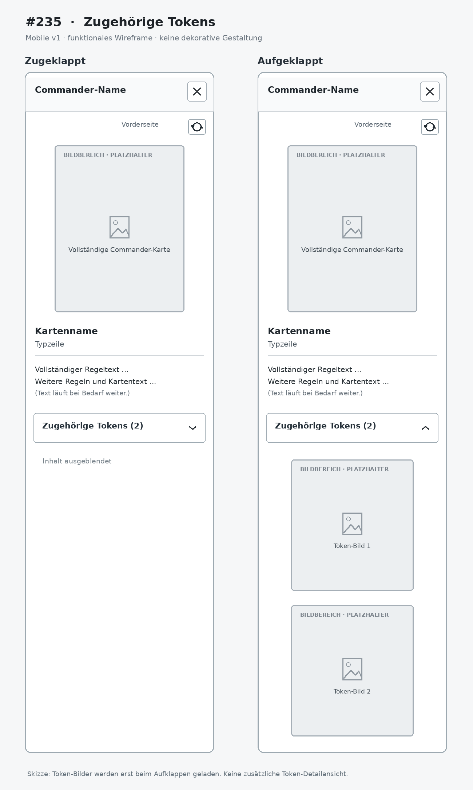

# PO-approved mobile functional wireframe for #235

This directory contains the **Product Owner-uploaded repository image** for the single mobile v1 token-accordion wireframe approved in [issue #235](https://github.com/GandalfTheJunior/mtg-commander-stats/issues/235) on 2026-11-09.

## Archive and visual reference

- **Repository image:** [`issue235_mobile_wireframe_v1.png`](issue235_mobile_wireframe_v1.png)
- **Preview:** 
- **Original approved attachment:** [issue #235 source image](https://github.com/user-attachments/assets/97f82238-0ee1-40b2-a75d-4fb7f8affbab).
- **GitHub file metadata:** 79,145 bytes, Git blob `583b4c4c21d41091d3d4ca8dff2457e186d81c1e`.
- **Dependency:** [#239 full-card viewer merged in PR #313](https://github.com/GandalfTheJunior/mtg-commander-stats/pull/313); [#234 stored token snapshot backend](https://github.com/GandalfTheJunior/mtg-commander-stats/issues/234) is also merged.

The previously uploaded `issue239_mobile_wireframe_v1.png` was **byte-identical to #239's archive** and has been deleted from this branch. The current image has a **different Git blob SHA and byte length** from #239's archived image (`b02098247bf8100d28d2da856972f0ffdd852770`, 68,390 bytes). This proves it is **not the same binary** as #239, but does not by itself prove visual equivalence to the original #235 attachment.

### Verification and outstanding review gate

- **Verified:** the new image exists in the correct repository directory, is linked by its committed filename above, and is distinct from #239's image.
- **Verified:** the PR changed-file list consists of this image and the README only.
- **Not independently verified here:** PNG signature, pixel dimensions, actual image appearance and comparison with the approved issue attachment. The available integration cannot decode image blobs; do not infer visual verification from filename or Git hash alone.
- **Required before PO merge:** open the committed image and original #235 attachment, visually compare their collapsed/expanded token accordion controls and layout, confirm the committed image displays correctly, obtain independent review and required successful CI on final PR HEAD.

## Design authority and implementation boundaries

The approved image governs **accordion placement, collapsed/expanded control inventory, one-column token-card arrangement and relative hierarchy**, not exact dimensions, colors or decoration. The written #235 specification remains authoritative for data, visibility, error states, image loading, permissions and accessible interaction. No separate desktop wireframe is required.

After the documentation PR is independently reviewed, passes current-HEAD CI and is merged with PO approval, the separately authorized #235 Implementer must open this **actual committed image** and read the full issue. Extend the existing `frontend/src/FullCardView.tsx` from #239, consuming only #234's stored, authorized nullable `relatedTokens` snapshots. Related tokens are tied to the saved Commander printing, not the currently selected card face; the token accordion is Commander-only and collapsed by default.

For subsequent PO iPhone acceptance, check two user-reported examples: **Sorin of House Markov // Sorin, Ravenous Neonate** (Food token) and **Koma, Cosmos Serpent** (3/3 blue Serpent token named Koma's Coil). Verify that the **saved printing's** `relatedTokens` snapshot actually includes the expected token before interpreting a missing entry as a UI defect. These are test candidates, not an authorization to infer token relationships from rules text.

This archive has **no production runtime changes** and does **not** authorize implementing #235, merging or deploying.
