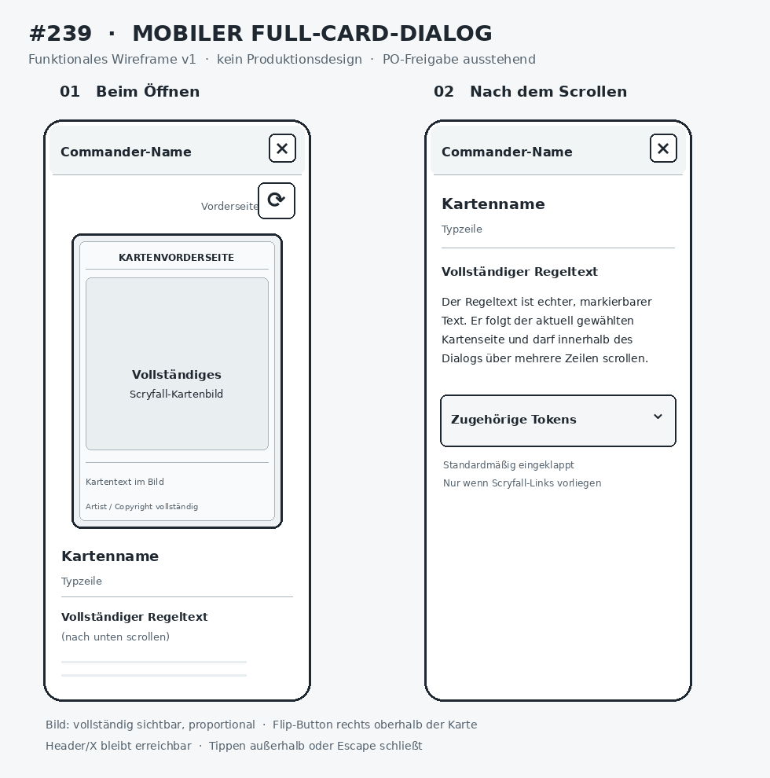

# PO-approved mobile functional wireframe for #239

This directory contains the **repository-local image uploaded by the Product Owner** for the single mobile v1 full-card viewer wireframe approved in [#239](https://github.com/GandalfTheJunior/mtg-commander-stats/issues/239) on 2026-11-09.

## Repository image and approval

| Item | Reference |
| --- | --- |
| Repository file | [`IMG_2483.png`](IMG_2483.png) |
| Direct image preview |  |
| GitHub file metadata | `IMG_2483.png`, 68,390 bytes, Git blob `b02098247bf8100d28d2da856972f0ffdd852770` |
| Approved original issue attachment | [Mobile v1 source](https://github.com/user-attachments/assets/f258135b-c41c-4bd9-bb64-60374d68908c) |
| Binding behavior and acceptance criteria | [Issue #239](https://github.com/GandalfTheJunior/mtg-commander-stats/issues/239) |

The PO uploaded `IMG_2483.png` to the archive branch. GitHub confirms it is a file in the intended directory. **Its image contents and pixel dimensions have not been independently inspected in this tool environment**, which cannot decode repository image blobs; the `.png` extension is reported, not independently signature-verified. No byte-for-byte equality to the original issue attachment is asserted.

**Review gate:** Open and visually inspect the committed image in GitHub, compare its layout/control hierarchy with the approved mobile v1 attachment on #239, verify that the binary opens as a valid image and record the dimensions if useful. The PO's upload is not by itself proof of byte identity. Do not mark this check complete without inspecting the actual image.

## Design authority

- The approved mobile v1 wireframe governs **control inventory, grouping, visual hierarchy and interaction placement**, not exact pixels, color values, decorative styling or motion frames.
- The written #239 specification governs dynamic interactions and edge cases, including complete uncropped saved card images, face switching, 350 ms 3D turn, reduced motion, accessible focus/close behavior, and responsive desktop two-column layout.
- The PO expressly decided that **no separate desktop wireframe** is required for #239.
- #235 related Commander tokens is an independently authorized later extension; this archive does not approve token UI under #239.

## Implementation and handoff

After this documentation PR has passed independent image review, final-HEAD CI and PO merge approval, the separate #239 Implementer should open `docs/product/wireframes/239/IMG_2483.png` and read the complete #239 issue. Reuse `frontend/src/FullCardView.tsx` and the completed #222 snapshot foundation across #195, #199 and #201. Do not introduce a second viewer, new card-metadata requests or decorative Cozy styling.

This documentation-only PR neither modifies runtime code nor authorizes implementing #239, #235 or other work.
